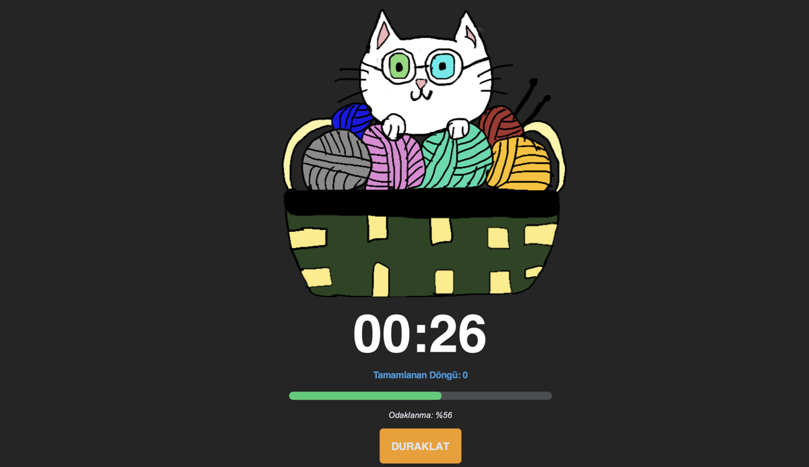
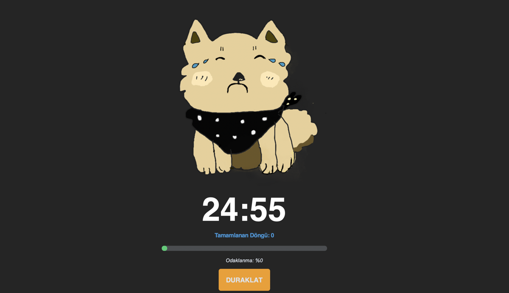
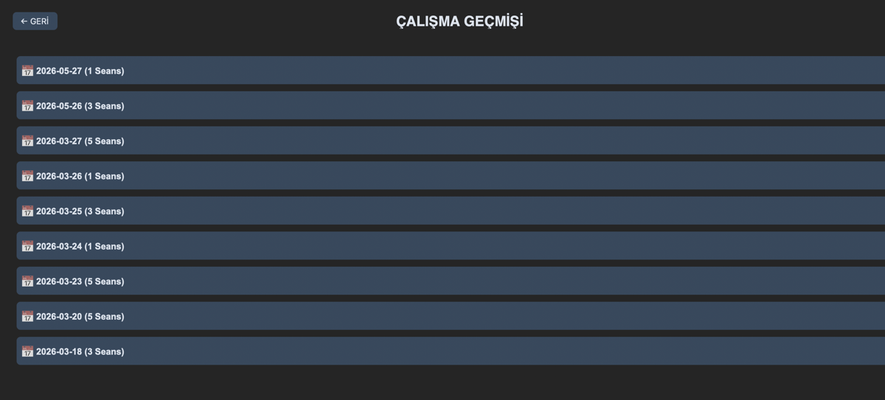

# 🐝 POMODORO DESKTOP APP

**Görsel Odaklanma ve Karakter Evrimi Uygulaması**

Standart Pomodoro tekniğini daha verimli ve eğlenceli hale getirmek için geliştirilmiş bir masaüstü uygulaması. Çalışırken seçtiğin karakter, odaklanma süresine göre gelişir; tüm çalışma seansların kaydedilir ve gün bazında incelenebilir.

## 📸 Ekran Görüntüleri

### Zamanlayıcı ve Karakter
Sayaç, tamamlanan döngü sayısı, odaklanma çubuğu ve duraklatma butonu tek ekranda.

<p align="center">
  
  
</p>

### Çalışma Geçmişi
Seanslar güne göre gruplanır ve katlanabilir bir akordeon menüde listelenir.

<p align="center">
  
</p>

## ✨ Öne Çıkan Özellikler

* **Dinamik Evrim Sistemi:** Çalışma süresine bağlı olarak seçtiğin karakter 5 farklı aşamada gelişir.
* **Odaklanma Takibi:** Her seansta ilerleme çubuğu ve odaklanma yüzdesi gösterilir.
* **Gelişmiş Geçmiş Paneli:** SQLite entegrasyonu ile tüm çalışma seansları kayıt altına alınır.
* **Akordeon Menü Yapısı:** Gün bazlı gruplandırılmış, katlanabilir ve modern bir geçmiş arayüzü sunar.
* **Özgün Dijital Sanat:** Uygulamadaki tüm figürler **Sketchbook** ile dijital olarak çizilmiş ve PNG formatında optimize edilmiştir.

## 🛠️ Kullanılan Teknolojiler

| Alan | Teknoloji |
|---|---|
| Programlama Dili | Python |
| Arayüz (GUI) | CustomTkinter |
| Veritabanı | SQLite3 (yerel veri depolama) |
| Görsel İşleme | Pillow |
| Grafik Tasarım | Sketchbook |

## 🚀 Kurulum ve Çalıştırma

1. Projeyi klonla:

   ```bash
   git clone https://github.com/emely022/POMODORO-DESKTOP-APP.git
   ```

2. Klasörün içine gir:

   ```bash
   cd POMODORO-DESKTOP-APP
   ```

3. Sanal ortamı oluştur ve aktif et:

   ```bash
   python3 -m venv venv
   source venv/bin/activate
   ```

4. Gerekli kütüphaneleri yükle:

   ```bash
   pip install -r requirements.txt
   ```

5. Uygulamayı başlat:

   ```bash
   python3 main.py
   ```

## 👥 Geliştiriciler

Bu proje, yazılım mimarisinden görsel tasarıma kadar her aşamada eşit sorumluluk paylaşılarak geliştirilmiştir.

* **Yazılım & Algoritma & Grafik Tasarım & UI/UX:** [Hakan URAL](https://github.com/HakanURAL06) & [Emel YURT](https://github.com/emely022)
